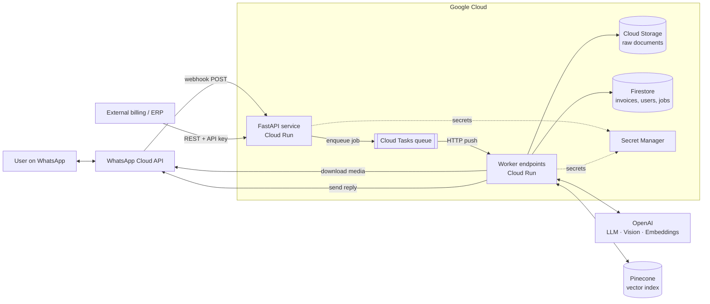
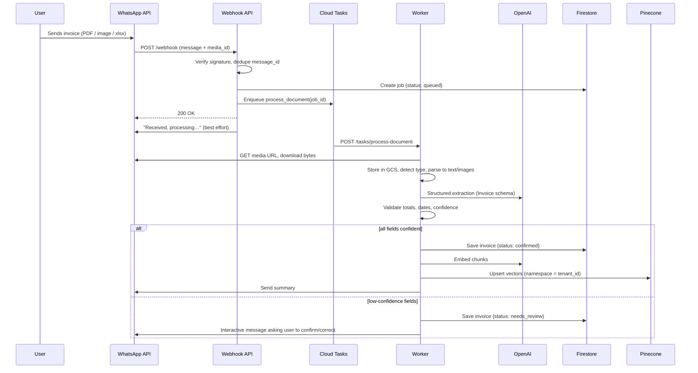
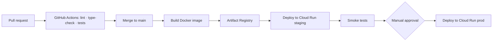

# Architecture: WhatsApp AI Billing Bot

> Product context, scope, and milestones: see [PROJECT.md](PROJECT.md).

## 1. System Overview



**Design principles**

1. **Acknowledge fast, process async.** The webhook only verifies, deduplicates, and enqueues, then returns `200` in under a second. All heavy work runs in workers.
2. **Structured data is the source of truth.** Firestore holds validated invoice records. Pinecone is a derived search index that can be rebuilt from Firestore and GCS.
3. **Tenant isolation everywhere.** Every record, file path, and vector is keyed by `tenant_id`, and every query is filtered by it.
4. **Ground every answer.** The LLM answers only from retrieved records or tool results, never from memory.
5. **Stateless services.** Cloud Run instances hold no state. Conversation state lives in Firestore.

## 2. Components

| Component | Responsibility | Module |
|---|---|---|
| **Webhook API** | Verify `X-Hub-Signature-256`, handle the `GET` verification challenge, dedupe by message ID, enqueue | `app/api/webhook.py` |
| **WhatsApp client** | Send text/template/interactive messages, fetch media URLs, download media | `app/whatsapp/` |
| **Task workers** | Cloud Tasks targets: `process_document`, `answer_query` | `app/api/tasks.py` |
| **Ingestion** | Store originals in GCS, detect MIME type, route to the right parser | `app/ingestion/` |
| **Parsers** | PDF (text layer via `pdfplumber`, vision fallback for scans), Excel/CSV (`pandas`/`openpyxl`), images (OpenAI vision), plain text | `app/ingestion/parsers/` |
| **Extraction engine** | LangChain chain with structured output into the `Invoice` Pydantic schema, plus validation and confidence scoring | `app/extraction/` |
| **Indexer** | Chunk invoice text and summary, embed, upsert to Pinecone with metadata | `app/search/indexer.py` |
| **Conversation router** | Classify intent (upload / query / confirm / help), manage session state | `app/conversation/` |
| **Query service** | The LLM turns a question into a structured `QueryPlan`. The service then runs it deterministically against Firestore (aggregates, lists, lookups) or Pinecone (semantic search). | `app/search/query_service.py`, `app/search/planner.py` |
| **AI provider** | One interface for extraction, planning, answers, corrections and embeddings. `OpenAIProvider` (LangChain) in production; `FakeAIProvider` (offline heuristics) for local use and CI. | `app/ai/` |
| **Invoice service** | Ingest pipeline, duplicate detection, confirm/correct/pay/delete | `app/services/invoice_service.py` |
| **Integration API** | REST endpoints for external systems | `app/api/invoices.py` |
| **Repositories** | Typed data access, Firestore plus an in-memory version with the same contract | `app/repositories/` |
| **Container** | Builds every service from settings, so each backend can be swapped (`memory`/`gcp`, `fake`/`openai`, …) | `app/container.py` |

## 3. Core Flows

### 3.1 Invoice upload



### 3.2 Natural-language query

1. The webhook receives a text message, and the router classifies it as `query`.
2. An `answer_query` task is enqueued (or run inline when the expected latency is low).
3. The LLM converts the question and recent history into a structured **`QueryPlan`**: intent (`aggregate`, `list`, `lookup`, `search` or `smalltalk`), vendor, resolved date range, payment status, metric and group-by. The service then executes the plan:
   - **aggregate:** exact sums, counts and averages from Firestore records, grouped by currency so currencies are never mixed. Arithmetic always happens in code, never in the LLM.
   - **list / lookup:** filtered Firestore queries.
   - **search:** semantic search in Pinecone (tenant namespace, with metadata filters), then the full records are fetched from Firestore.
4. Aggregate, list and lookup replies are formatted in code, which keeps numbers exact and saves an LLM call. Search replies are written by the LLM, grounded only in the retrieved records and citing invoice numbers. If nothing matches, the bot says so.

   *Why a plan rather than a free-form tool-calling agent:* it needs one LLM call instead of several, its behaviour is predictable and testable, and the model can never invent a number.
5. The reply is sent via WhatsApp. Attachments (original PDF, CSV export) are sent through signed GCS URLs or re-uploaded as media.

### 3.3 Corrections

The user replies to a `needs_review` prompt, for example "Total is 1,250.00". The router maps the reply to the pending invoice in the session state, patches the field, re-validates, sets `confirmed`, and re-indexes.

## 4. Data Model

### 4.1 Firestore

```
tenants/{tenant_id}
    name, plan, created_at, settings{currency, timezone}

users/{wa_id}                             # top-level so a sender resolves to a tenant in one read
    tenant_id, display_name, role, created_at, last_active_at

api_keys/{sha256(key)}                    # integration API keys (only hashes stored)
    tenant_id, name, created_at

tenants/{tenant_id}/invoices/{invoice_id}
    invoice_number, invoice_date, due_date, currency
    vendor{name, tax_id, address, email, phone}
    customer{name, tax_id, address}
    line_items[{description, quantity, unit_price, amount, tax_rate}]
    subtotal, tax_total, discount, total
    payment_status: unpaid | paid | partial | unknown
    status: processing | needs_review | confirmed | failed
    confidence{field: 0..1}, validation_errors[]
    source{gcs_uri, mime_type, wa_message_id, sha256}
    summary, created_by, created_at, updated_at

tenants/{tenant_id}/jobs/{job_id}
    type, status, attempts, error, invoice_id, created_at, updated_at

processed_messages/{wa_message_id}        # idempotency; TTL 7 days
sessions/{wa_id}                          # conversation state; TTL 24 h
    tenant_id, pending_invoice_id, last_intent, history[]
```

**Indexes:** composite indexes on `(vendor.name, invoice_date)`, `(payment_status, due_date)`, and `(status, created_at)`.
**Duplicate detection:** the `source.sha256` of the file, plus `(vendor.name, invoice_number)`.

### 4.2 Extraction schema (Pydantic)

```python
class LineItem(BaseModel):
    description: str
    quantity: Decimal | None
    unit_price: Decimal | None
    amount: Decimal
    tax_rate: Decimal | None

class Party(BaseModel):
    name: str | None
    tax_id: str | None
    address: str | None
    email: str | None
    phone: str | None

class Invoice(BaseModel):
    invoice_number: str | None
    invoice_date: date | None
    due_date: date | None
    currency: str | None          # ISO 4217
    vendor: Party
    customer: Party
    line_items: list[LineItem]
    subtotal: Decimal | None
    tax_total: Decimal | None
    discount: Decimal | None
    total: Decimal
    field_confidence: dict[str, float]
```

**Validation rules:** `sum(line_items.amount) ≈ subtotal`, `subtotal − discount + tax_total ≈ total` (with a tolerance for rounding), `due_date ≥ invoice_date`, and a valid currency code. A failed rule lowers the confidence of the fields involved.

### 4.3 Pinecone

- **Index:** `invoices`, dimension matching the embedding model (for example `text-embedding-3-small`, 1536), cosine metric.
- **Namespace:** `tenant_id` (hard isolation).
- **Vector ID:** `{invoice_id}#{chunk_no}`.
- **Chunks:** (a) the invoice header and summary, (b) groups of line items.
- **Metadata:** `invoice_id`, `vendor`, `invoice_date` (epoch), `total`, `currency`, `payment_status`, `chunk_type`. These enable filtered retrieval, for example by date range or vendor.

### 4.4 Cloud Storage

```
gs://<bucket>/tenants/{tenant_id}/invoices/{yyyy}/{mm}/{invoice_id}/{original_filename}
```
The bucket is private and uses uniform bucket-level access. Downloads use short-lived signed URLs. A lifecycle rule can move objects to a colder storage class after N days.

## 5. API Surface

| Method | Path | Auth | Purpose |
|---|---|---|---|
| `GET` | `/webhook` | Verify token | WhatsApp webhook verification challenge |
| `POST` | `/webhook` | HMAC signature | Inbound WhatsApp events |
| `POST` | `/tasks/process-document` | Cloud Tasks OIDC | Document processing worker |
| `POST` | `/tasks/answer-query` | Cloud Tasks OIDC | Query worker |
| `POST` | `/tasks/reconcile-index` | Scheduler OIDC | Re-index invoices whose vector upsert failed |
| `GET` | `/v1/invoices` | API key | List or filter invoices |
| `POST` | `/v1/invoices` | API key | Upload an invoice (multipart) |
| `GET` | `/v1/invoices/{id}` | API key | Invoice detail plus a signed document URL |
| `PATCH` | `/v1/invoices/{id}` | API key | Correct fields, update payment status, confirm |
| `DELETE` | `/v1/invoices/{id}` | API key | Delete an invoice and its vectors |
| `POST` | `/v1/search` | API key | Semantic search / Q&A |
| `GET` | `/v1/exports/invoices.csv` | API key | CSV export |
| `GET` | `/healthz` | none | Liveness / readiness |

API keys are scoped to a tenant and stored hashed in Firestore.

## 6. Security

- **Webhook authenticity:** reject any request whose `X-Hub-Signature-256` HMAC (computed with the app secret) does not match.
- **Worker endpoints:** accept only Cloud Tasks requests that carry an OIDC token from the dedicated service account.
- **Secrets:** the WhatsApp token, app secret, OpenAI key, and Pinecone key are kept in Secret Manager and mounted as env vars at deploy time. Never commit them.
- **IAM:** each service has its own service account with least privilege (`storage.objectAdmin` on one bucket, `datastore.user`, `cloudtasks.enqueuer`).
- **Data:** encrypted at rest (Google-managed or CMEK) and in transit over TLS.
- **Tenant isolation:** `tenant_id` is resolved from the sender's `wa_id` on the server and never taken from user input. Automated tests check that no query crosses tenants.
- **Logging:** structured JSON with phone numbers and amounts redacted. No document contents in logs.
- **Abuse protection:** per-user rate limits, maximum file size (for example 20 MB), and a MIME allow-list.
- **LLM safety:** document text is treated as untrusted data and kept apart from system instructions, which limits prompt injection from invoice content.

## 7. Reliability and Error Handling

| Concern | Approach |
|---|---|
| WhatsApp webhook retries | Idempotency through `processed_messages/{message_id}` |
| Worker failure | Cloud Tasks retries with exponential backoff (max 5). Jobs track `attempts`. After that, `failed`, and the user is notified. |
| Media URL expiry | Download inside the worker right away. On a `401`/`404`, re-fetch the media URL. |
| LLM/API errors | `tenacity` retries on 429/5xx. Fall back to a secondary model for extraction. |
| Pinecone outage | The invoice is still saved as `confirmed` with `indexed=false`. A reconcile job re-indexes later. |
| 24-hour session window | Notifications outside the window use approved message templates. |
| Cold starts | `min-instances=1` for the webhook service |

## 8. Observability

- **Logging:** structured logs to Cloud Logging, with a `trace_id` carried from the webhook through the task to the reply.
- **Metrics:** processing latency, extraction confidence distribution, `needs_review` rate, LLM tokens and cost per tenant, and queue depth.
- **Tracing:** OpenTelemetry to Cloud Trace. LangSmith (optional) for LangChain chains.
- **Alerts:** error rate > 2%, p95 processing time > 60 s, task queue backlog.

## 9. Deployment and CI/CD



- **CI checks:** `ruff`, `mypy`, `pytest` (unit tests plus Firestore emulator integration tests) and an extraction accuracy regression test against fixtures.
- **Auth to GCP:** Workload Identity Federation, so no long-lived keys are stored in GitHub.
- **Container:** `python:3.13-slim` base, multi-stage build, non-root user, `uvicorn` with workers sized to the Cloud Run CPU.
- **Environments:** `dev`, `staging`, and `prod`, each a separate GCP project with its own WhatsApp phone number.
- **Infrastructure:** Terraform in `infra/` (Cloud Run, Tasks queues, bucket, Firestore, IAM, secrets).

## 10. Configuration

| Variable | Description |
|---|---|
| `WHATSAPP_TOKEN` | Cloud API access token (secret) |
| `WHATSAPP_APP_SECRET` | Used to verify webhook signatures (secret) |
| `WHATSAPP_VERIFY_TOKEN` | Webhook verification challenge token (secret) |
| `WHATSAPP_PHONE_NUMBER_ID` | Sender phone number ID |
| `OPENAI_API_KEY` | OpenAI key (secret) |
| `OPENAI_CHAT_MODEL` / `OPENAI_EMBED_MODEL` | Model selection |
| `PINECONE_API_KEY` / `PINECONE_INDEX` | Vector store (key is secret) |
| `GCP_PROJECT` / `GCS_BUCKET` | Cloud resources |
| `TASKS_QUEUE` / `TASKS_LOCATION` / `TASKS_SERVICE_ACCOUNT` | Async processing |
| `MAX_UPLOAD_MB` | Upload size limit |
| `LOG_LEVEL` | Logging verbosity |

## 11. Scalability

- Cloud Run autoscales both the webhook and worker services. Worker concurrency is tuned low (for example 4–8) because LLM calls are I/O-bound and memory-heavy for PDFs.
- The Cloud Tasks queue `max_dispatches_per_second` stays under the OpenAI rate limits.
- Firestore and Pinecone scale horizontally. Tenant namespaces keep searches small.
- Future work: batch uploads (ZIP or multi-file), a Pub/Sub event stream for ERP sync, and per-tenant fine-tuned extraction prompts.
